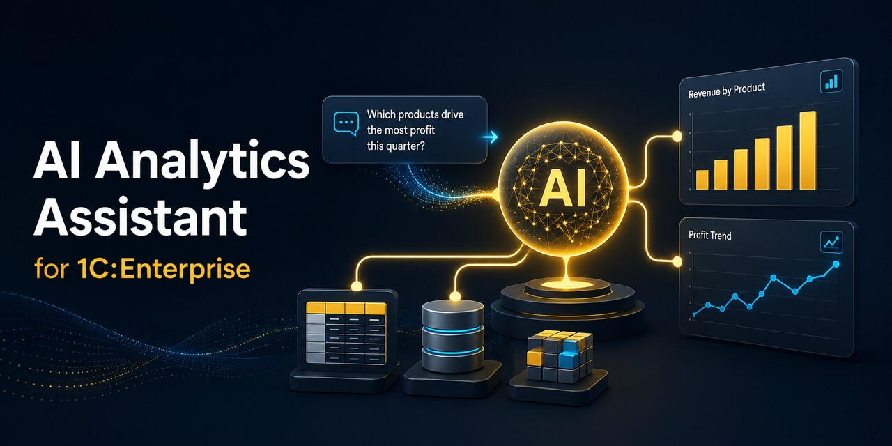
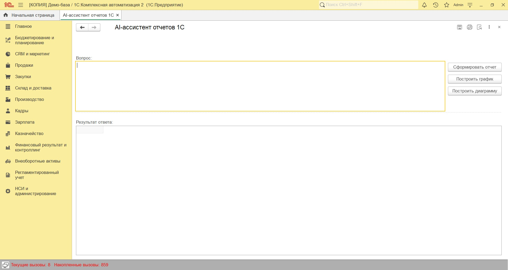
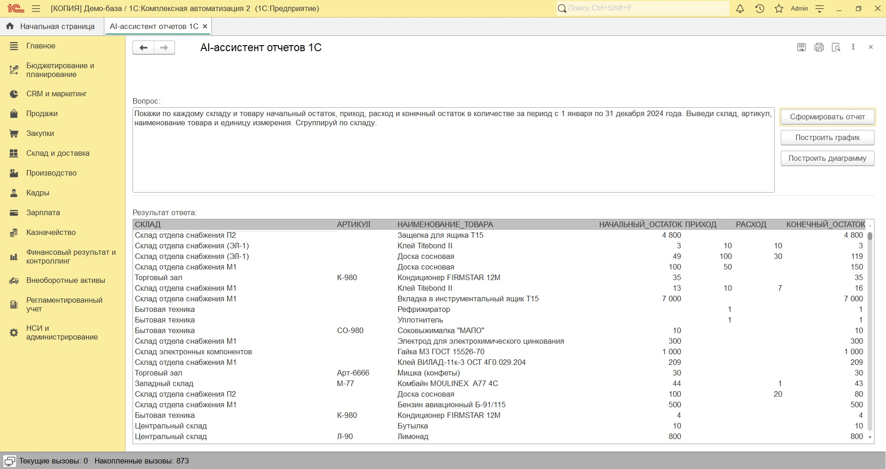
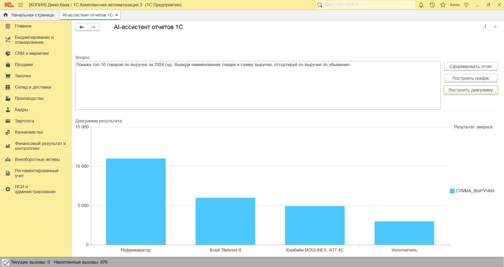
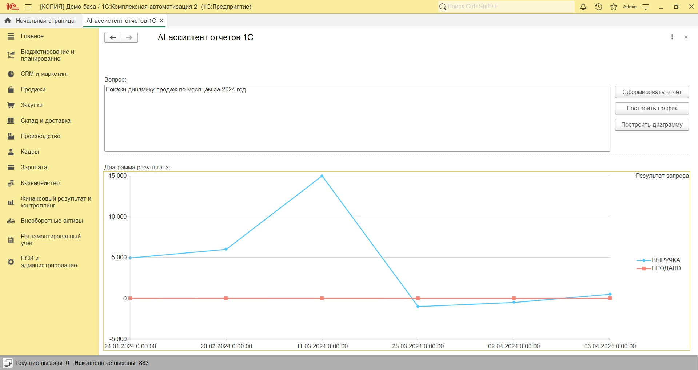

**English** | [Русский](README_RU.md) | [Azərbaycan dili](README_AZ.md)

# AI Consultant for 1C:Enterprise — v3

AI Consultant helps users retrieve analytical reports in 1C through natural-language questions. It supports questions in **Russian and Azerbaijani**.

The project has reached its **third product version**. The current demo uses standard 1C reports and the Data Composition System (DCS).

## What changed in v3

The project has evolved from analytical query generation and custom visualization to configuring standard reports.

AI identifies the user’s task and report parameters: period, groupings, filters, and metrics. The application validates these against the available scenario catalog and applies them to a configured report variant. Calculations and report generation run through 1C.

A shared scenario-processing mechanism allows the solution to grow by connecting and configuring additional reports.

## Demo capabilities

- Sales analysis by customer, product, and organization.
- Purchasing analysis by supplier and product.
- Inventory movement analysis by warehouse and product.
- Report configuration through natural-language questions.
- Processing of Russian and Azerbaijani requests.

Example questions in the supported languages:

- “Покажи выручку за 2024 год по клиентам и номенклатуре”.
- “2024-cü il üzrə müştərilər və məhsullar üzrə satış gəlirini göstər”.
- “2023-cü ildə təchizatçılar üzrə alışları göstər”.
- “Anbarlar üzrə mal hərəkətini göstər”.

## Current status

Available capabilities depend on the reports and report variants configured in each 1C database. Testing, expansion of analytical scenarios, and improvements to cash-flow reporting are ongoing. Support for more complex analytical requests is planned.

Technologies: 1C:Enterprise 8.3, BSL, DCS, standard reports, OpenAI API, HTTP/JSON.

This repository contains the public product description and demonstration materials. Source code, distribution files, and internal AI instructions are not published.

## Screenshots from previous versions

The following images show the interface and visualization features of previous product versions. They are not v3 screenshots. The materials were created using a demonstration database.

