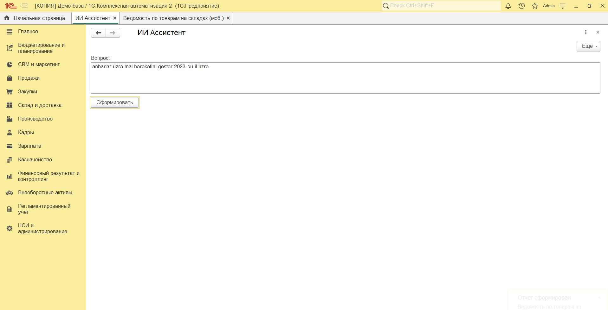
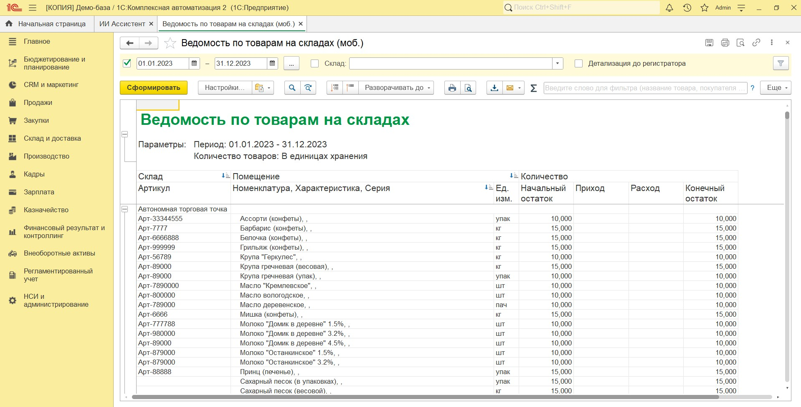
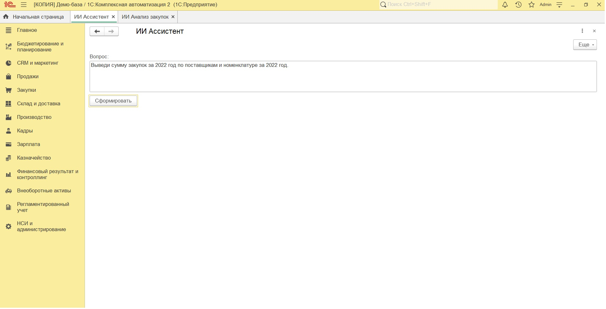
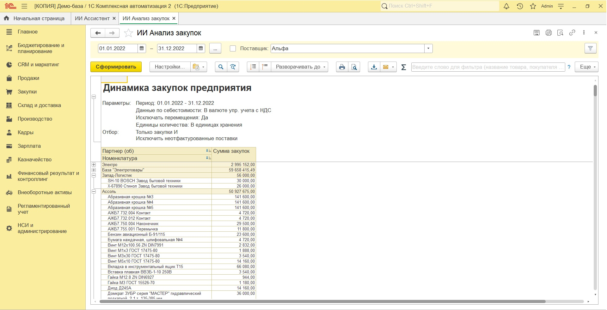

[English](README.md) | **Русский** | [Azərbaycan dili](README_AZ.md)

# ИИ-консультант для 1С:Предприятия — v3

ИИ-консультант помогает получать аналитические отчёты в 1С с помощью вопросов на естественном языке. Поддерживаются запросы на **русском и азербайджанском языках**.

Проект находится на этапе **третьей версии продукта**. Текущая демоверсия использует типовые отчёты 1С и систему компоновки данных — СКД.

## Что изменилось в v3

Проект прошёл путь от генерации аналитических запросов и собственной визуализации к настройке типовых отчётов.

ИИ определяет задачу пользователя и её параметры: период, группировки, отборы и показатели. Приложение проверяет их по каталогу доступных сценариев и применяет к настроенному варианту отчёта. Расчёты и формирование результата выполняются средствами 1С.

Единый механизм обработки сценариев позволяет расширять возможности решения через подключение и настройку дополнительных отчётов.

## Возможности демоверсии

- Анализ продаж по клиентам, товарам и организациям.
- Анализ закупок по поставщикам и товарам.
- Анализ движения товаров по складам и номенклатуре.
- Настройка параметров отчёта по текстовому запросу.
- Обработка русских и азербайджанских формулировок.

Примеры запросов:

- «Покажи выручку за 2024 год по клиентам и номенклатуре».
- «2024-cü il üzrə müştərilər və məhsullar üzrə satış gəlirini göstər».
- «2023-cü ildə təchizatçılar üzrə alışları göstər».
- «Anbarlar üzrə mal hərəkətini göstər».

## Текущий статус

Доступные возможности зависят от подключённых отчётов и настроенных вариантов в конкретной базе. Продолжаются тестирование, расширение аналитических сценариев и доработка отчётности по движению денежных средств. В планах — поддержка более сложных аналитических запросов.

Технологии: 1С:Предприятие 8.3, BSL, СКД, типовые отчёты, OpenAI API, HTTP/JSON.

Репозиторий содержит публичное описание и демонстрационные материалы. Исходный код, файлы поставки и внутренние инструкции ИИ не публикуются.

## Демонстрация v3: вопрос → отчёт

Скриншоты демонстрационной базы показывают текстовый вопрос и полученный типовой отчёт 1С.

### Движение товаров — вопрос на азербайджанском

Вопрос: «anbarlar üzrə mal hərəkətini göstər 2023-cü il üzrə».

Результат: ведомость по товарам на складах за 01.01.2023–31.12.2023 с начальным остатком, приходом, расходом и конечным остатком.

### Анализ закупок — вопрос на русском

Вопрос о сумме закупок за 2022 год по поставщикам и номенклатуре.

Результат: отчёт по закупкам за 01.01.2022–31.12.2022 с группировкой по поставщикам и номенклатуре.

## Скриншоты предыдущих версий

Следующие изображения показывают интерфейс и визуализацию предыдущих версий продукта. Они не являются скриншотами v3. Материалы созданы на демонстрационной базе.

